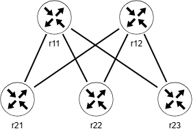

# Topology Design from Requirements

In this lab you will build a data centre spine-leaf fabric that will be used throughout the course.

# Lab Objectives

By the end of this lab, you will be able to:

1. Explain the role a tool such as netlab plays in translating a network design into a deployable topology, and identify where that translation catches structural errors.
2. Build and deploy single node and multi node topologies using netlab with a Containerlab provider, and observe the abstraction layer between the two tools.
3. Translate a written design brief, a topology diagram and an addressing plan, into a correct netlab topology file, including explicit loopback and point to point addressing.
4. Inspect the Ansible inventory and variables netlab generates from a topology file, trace where values netlab uses (credentials, addresses, template variables) come from, and explain how its hierarchical structure can be used for configuration management.
5. Compare a deployed topology against its original design intent and use automated reporting tools to generate design documentation.

# Lab Environment and Preparation

You will need:

- Your assigned Ubuntu VM IP address provided in Brightspace: ________________.
- netlab, Containerlab, Docker, Ansible, and Python 3 preinstalled.
- The `ceos:v4.36`[^ceos] and `frr` Docker image is available locally.


## If Things Go Wrong

>- YAML is indentation sensitive. Before running netlab create or netlab up on a file you hand typed or edited, validate it with `python3 -c "import yaml; yaml.safe_load(open('topology.yml'))"`. netlab create also reports most attribute and syntax errors clearly, read the first error in a long traceback, later ones are often consequences of it.
>- If netlab up reports that a node failed to start, run netlab down before trying again. Starting a second attempt on top of a half deployed topology produces confusing container name collisions.
>- If two topologies happen to claim the same management subnet because you left an older lab running, run netlab down on the older one first.
>- Run the `ansible-inventory` commands in this lab from the topology folder, where netlab writes `hosts.yml`. If the command reports that it cannot find the inventory, check your current folder with `pwd` and that the topology was created or deployed before you cleaned it up.
>- If you damage the VM itself rather than just the lab environment, stop and contact your instructor rather than continuing to troubleshoot.

[^ceos]: This lab was tested using Arista cEOS `ceos:v4.36`.


# Background

## Netlab and Ansible

Netlab is an open-source command-line tool designed to simplify the creation and deployment of virtual network labs. It allows users to define complex network topologies using a simple YAML file, from which it automatically generates configurations for virtualization platforms, such as containerlab, creates IP addressing plans, and deploys initial device configurations for various networking protocols (such as OSPF, BGP, and VLANs) across multi-vendor environments.

Netlab uses Ansible to simplify the deployment and management of virtual network labs. To create a topology, netlab generates Ansible inventory files, group variables, and configuration paths. It then uses internal Ansible playbooks to push initial baseline settings, such as hostnames, management interfaces, and loopback IPs, to all virtual devices simultaneously. Netlab also relies on Ansible to deploy custom Jinja2 configuration templates and collect running facts from the lab. While recent updates have shifted some local Linux tasks to native Python to maximize speed, Ansible remains the core framework Netlab depends on to orchestrate and communicate with the virtual network devices in your lab environment.

## What netlab Generates

You write one file, the topology file. When you run `netlab create` (or `netlab up`, which runs `netlab create` first), netlab expands that file into a complete data model and writes it into the current folder as files that Ansible and Containerlab can use. Table \ref{tb:files} summarizes the important ones.

| File or folder | What it holds |
| :--- | :---------- |
| `hosts.yml` | The Ansible inventory: every node, and the groups they belong to (the groups you defined, such as `spine` and `leaf`, plus groups netlab adds itself) |
| `group_vars/` | Variables shared by a group of nodes, including parts of the topology data model |
| `host_vars/<node>/` | Variables for one node: its management address, interfaces, IP addresses, and module data such as OSPF |
| `clab.yml` | The Containerlab provider file (the part Containerlab consumes) |
| `ansible.cfg` | The Ansible settings netlab uses when it runs playbooks |

Table: Files netlab generates from a topology file \label{tb:files}

You will not edit these files. They are regenerated from the topology file every time, so the topology file remains the single source of truth. You will, however, read them, because many things that seem to happen by magic (how netlab logs in to a device, how an address ends up on an interface, where a template gets its values) are simply values in this data.

Two Ansible commands are enough to explore it:

```bash
ansible-inventory --graph
ansible-inventory --host <node>
```

The first shows the inventory as a tree of groups and nodes. The second shows every variable Ansible would use for a single node, after all group and host variables have been merged. You will use both throughout this lab.

Notice that `ansible-inventory` did not include the `-i <inventory>` option because the inventory file name is included in `ansible.cfg` file.

## Lab Topology

You will build a spine-and-leaf fabric common in data centre network. The fabric consists of two spine and three leaf routers. Figure \ref{fg:topo} shows this fabric.




In this topology, every spine node (`r11`, `r12`) connects to every leaf node (`r21`, `r22`, `r23`). There is no link between the two spine nodes, and no link between any pair of leaf nodes. Out of band management addressing is not part of this design brief. netlab and Containerlab provision and manage a separate management network automatically, you do not need to design or configure one for this lab.


# Part A: netlab and Containerlab Fundamentals

## Task 0: netlab and Containerlab Environment Review

Objective: confirm your environment is ready. You will not deploy anything in this task.

1. Confirm netlab is installed and check the version.

   ```bash
   netlab version
   ```

2. Confirm Containerlab is installed and check the version.

   ```bash
   containerlab version
   ```

3. Confirm Docker is available and that the required images are present.

   ```bash
   docker --version
   docker image ls
   ```

   You should see `ceos:v4.36` and an FRR image in the list.

4. Confirm Ansible is installed. netlab depends on it, and you will read the data netlab generates for it in later tasks.

   ```bash
   ansible --version
   ansible-inventory --version
   ```

5. Ask netlab what it already knows about the devices it uses.

   ```bash
   netlab show images
   ```

   This lists every device kind netlab recognizes and, where configured, the container image it will use for each one. Confirm `eos` and `frr` both appear with the image tags matching the docker images.

6. List the configuration modules netlab makes available for building topologies.

   ```bash
   netlab show modules
   ```

### Questions and Deliverables

1. Provide the output of netlab show images.
2. Which container image does netlab associate with the `eos` device kind, and which with `frr`?
3. Which Ansible version is installed?

## Task 1: First netlab Topology

Objective: build, connect to, and tear down a single node before working with a full fabric, and find the inventory data netlab generated for it.

1. Create the folder structure this lab will use.

   ```bash
   mkdir -p ~/labs/lab1/topology
   cd ~/labs/lab1/topology
   ```

2. Create a minimal topology file with a single node (ensure correct indentation).

   ```bash
   cat << EOF > test-eos.yml
   name: test-eos
   provider: clab

   defaults:
     device: eos

   nodes:
     r1:
   EOF
   ```

3. Deploy it.

   ```bash
   netlab up test-eos.yml
   ```

4. Check its status and note its management address.

   ```bash
   netlab status
   ```

5. Look at what netlab generated in the topology folder, then ask Ansible what it knows about `r1`.

   ```bash
   ls
   ls host_vars group_vars
   ansible-inventory --graph
   ansible-inventory --host r1
   ```

   You wrote a topology file of a few lines. Notice how much data netlab has added for a single node. Find the management address you noted in step 4 in this output. Also find the variables whose names start with `ansible_`.

6. Connect to it.

   ```bash
   netlab connect r1
   ```

7. From the EOS prompt, run these commands, then exit.

   ```text
   show version
   show ip interface brief
   exit
   ```

8. Search the generated files for the variables that held the login information, so you know which file each one comes from.

   ```bash
   grep -rn ansible_user .
   grep -rn ansible_network_os .
   ```

9. Answer the questions below, then tear down this topology. The `--cleanup` option also removes the generated files from the folder.

   ```bash
   netlab down --cleanup
   ```

### Questions and Deliverables

1. Provide the output of netlab status from step 4.
2. What EOS software version did `show version` report?
3. netlab connect logged you in without asking for a username or password. Name the variables it used and the file they came from.
4. In the output of `ansible-inventory --host r1`, identify the variable that tells Ansible which kind of device `r1` is, and the variable that holds its management address.

## Task 2: A Second Device Kind

Objective: deploy a single FRR node, compare its CLI to EOS, and compare how the two kinds appear in the inventory.

1. Create a second temporary topology file.

   ```bash
   cat << EOF > test-frr.yml
   name: test-frr
   provider: clab

   nodes:
     f1:
       device: frr
   EOF
   ```

2. Deploy it.

   ```bash
   netlab up test-frr.yml
   ```

3. Compare the inventory data for this FRR node with what you saw for the EOS node in Task 1.

   ```bash
   ansible-inventory --host f1
   ```

4. Connect to it. FRR's CLI is `vtysh`, a Cisco style shell close enough to EOS syntax that most of what you type will look familiar. netlab will drop you into Linux shell, so you will need to enter `vtysh` in the next step. 

   ```bash
   netlab connect f1
   ```

5. Run the equivalent read only commands, then leave.

   ```text
   vtysh
   show version
   show interface brief
   exit
   exit
   ```

6. Answer the questions below before tear down the topology.

   ```bash
   netlab down --cleanup
   ```

This task shows that switching an entire fabric from EOS to FRR is a one line change, changing `device: eos` to `device: frr`. Everything else you build in this lab, the groups, the links, the addressing plan, is device kind agnostic and does not need to change if your environment requires the FRR image instead of EOS image for some or all nodes.

### Questions and Deliverables

1. Provide the output of `show version` from the FRR CLI.
2. Name one command whose syntax is identical between the EOS and FRR CLIs, and one that differs.
3. Compare the `ansible-inventory --host` output for `f1` with the output for `r1` from Task 1. Name two variables whose values differ because the device kind is different.


# Part B: Turning a Topology Design to a Deployed Fabric

## Task 3: Building the Fabric Skeleton

Objective: translate the topology described in this lab into a netlab topology file, test the compiler's structural validation, inspect the inventory it generates, deploy it, and examine the abstraction layer.

1. Before opening an editor, write down a short mapping between the design brief and the netlab constructs you intend to use, which nodes belong in a spine group, which in a leaf group, and how many links the topology needs in total. This mapping is one of the questions and deliverables for this task, do this step before step 2.

2. Create the persistent topology file. Deliberately introduce a typographical error in the links list to observe how netlab handles structural errors. Notice the final link references `r24`, a node that does not exist.

   ```bash
   cd ~/labs/lab1/topology
   nano dc-fabric.yml
   ```

   ```yaml
   name: dc-fabric
   provider: clab

   defaults:
     device: eos

   nodes:
     r11:
     r12:
     r21:
     r22:
     r23:

   groups:
     spine:
       members: [r11, r12]
     leaf:
       members: [r21, r22, r23]

   links:
     - r11-r21
     - r11-r22
     - r11-r23
     - r12-r21
     - r12-r22
     - r12-r24
   ```

3. Validate the structure by generating the configuration without deploying it.

   ```bash
   netlab create dc-fabric.yml
   ```

   You should receive a validation error indicating that node `r24` is not defined. Save the error message. Check whether the inventory files (`hosts.yml`, `host_vars`, `group_vars`) were created by this failed attempt. Fix the file by changing `r12-r24` to `r12-r23`, save the file, and run the command again. It should now complete successfully.

4. The successful `netlab create` produced the inventory without starting any containers. Inspect it before deploying.

   ```bash
   ls
   ansible-inventory --graph
   ansible-inventory --host r21
   ```

   Compare the groups in the graph with the `groups:` block in your topology file. Some groups come from your file and some are added by netlab. Then find in the `r21` output the list of interfaces and how many there are, and compare that with your links list.

5. Deploy the corrected topology.

   ```bash
   netlab up dc-fabric.yml
   ```

6. Check the high level status of the nodes using netlab.

   ```bash
   netlab status
   ```

7. Check the low level infrastructure state using the underlying Containerlab provider.

   ```bash
   containerlab inspect --name dc-fabric
   ```

8. Generate a diagram of what you just deployed and place it side by side with Figure \ref{fg:topo}.

   ```bash
   netlab create dc-fabric.yml -o graph:topology=dc-fabric.dot
   ```

9. The generated file is in dot format. You can view using the `dot` tool:

   ```bash
   dot -Tpng dc-fabric.dot -o dc-fabric.png
   ```
   
   You may also use containerlab to generate a graph of the topology:

   ```bash
   containerlab graph --name dc-fabric
   ```

   View the topology on your browser using the URL displayed on the screen, then type `CTRL-C` on the terminal to exit.

10. Use netlab's reporting engine to automatically generate an initial addressing report and a wiring report from your baseline intent file:

    ```bash
    netlab report addressing > addressing-report-initial.md
    netlab report wiring > wiring-report.md
    ```

### Questions and Deliverables

1. Submit your written mapping from step 1.
2. Provide the error message you received when running `netlab create` with the intentionally incorrect link. Did the failed attempt create any inventory files?
3. Provide the output of `ansible-inventory --graph`. Which groups did you define in `dc-fabric.yml`, and which were added by netlab?
4. Compare the outputs of `netlab status` and `containerlab inspect --name dc-fabric`. Describe in your own words the relationship between these two tools and what netlab abstracts away from the user.
5. Attach your generated `.png` graph from step 9. Does it match the shape of Figure \ref{fg:topo}? If not, where does it differ?
6. Inspect the generated `addressing-report-initial.md` and `wiring-report.md` files. How do they reflect the baseline skeleton topology you just built?

## Task 4: Automated Addressing and Intent-Driven IGP Provisioning

Objective: leverage `netlab`'s intent-based automation to automatically allocate loopbacks and point-to-point link subnets from defined pools, provision an Interior Gateway Protocol (OSPF) across the fabric without writing configurations, and trace the allocated values back to the generated inventory.

1. Open `dc-fabric.yml` and introduce a top-level `addressing` block to define address pools for loopbacks and links, and enable the OSPF configuration module. This replaces the default netlab IP addressing with custom addressing blocks.

   ```yaml
   name: dc-fabric
   provider: clab

   defaults:
     device: eos

   module: [ ospf ]

   addressing:
     loopback:
       ipv4: 10.0.0.0/24
     link:
       ipv4: 10.1.0.0/16

   nodes:
     r11:
     r12:
     r21:
     r22:
     r23:

   groups:
     spine:
       members: [r11, r12]
     leaf:
       members: [r21, r22, r23]

   links:
     - r11-r21
     - r11-r22
     - r11-r23
     - r12-r21
     - r12-r22
     - r12-r23
   ```


2. Validate the syntax using Python's YAML parser, then tear down the old topology and deploy the updated intent-driven model:

   ```bash
   python3 -c "import yaml; yaml.safe_load(open('dc-fabric.yml'))"
   netlab restart
   ```

   Note: the `restart` command needs to be executed from the topology folder.

3. Connect to spine `r11` and examine how `netlab` automatically assigned IP addresses to the interfaces and configured OSPF based on your high-level intent:

   ```text
   netlab connect r11
   show ip interface brief
   show ip ospf neighbor
   ```

4. Verify that OSPF has formed full adjacencies with all three leaf nodes (`r21`, `r22`, and `r23`), and check the routing table to confirm that all remote loopbacks are learned dynamically through the abstraction layer:

   ```text
   show ip route ospf
   ```

5. Test end-to-end logical reachability by pinging a remote leaf loopback address directly from `r11` without having to define static routes.

6. Exit the device and trace the addresses you just saw back to their source. The values on the device came from the inventory data, and the inventory data came from the pools in your `addressing` block.

   ```bash
   ansible-inventory --host r11
   ```

   In the output, find the loopback address, the list of interfaces with their addresses, and the OSPF data (the router ID and area). Match each interface address to the output of `show ip interface brief` from step 3, and confirm that the loopback address falls inside the loopback pool and the interface addresses inside the link pool.

### Questions and Deliverables

1. Provide the output of `show ip interface brief` from `r11`. How did `netlab`'s addressing pools determine the subnet blocks assigned to each link compared to manual assignment?
2. Provide the output of `show ip ospf neighbor` and `show ip route ospf`. Explain how enabling the single line `module: [ ospf ]` eliminated the need for manual routing protocol configurations.
3. Confirm end-to-end reachability between nodes using `ping` and provide the output.
4. From `ansible-inventory --host r11`, list the loopback address, the address of the interface towards `r21`, and the OSPF router ID. Which pool or rule produced each one?


## Task 5: Multi-Vendor Interoperability Prototyping

Objective: test design portability and catch vendor interoperability edge cases by mixing different device kinds (Arista EOS and FRR) within the same fabric, observing how `netlab` abstracts platform-specific protocol configurations and what changes in the inventory when a device kind changes.

1. Before changing anything, save the inventory data of `r11` as it stands now, with `r11` still an EOS node:

   ```bash
   ansible-inventory --host r11 > r11-eos.json
   ```

2. Open `dc-fabric.yml` and modify the spine nodes `r11` and `r12` to use the `frr` device kind instead of the default EOS image. This introduces a mixed-vendor architecture to validate protocol interoperability.

   ```yaml
   r11:
     device: frr
   r12:
     device: frr
   ```

3. Tear down the previous topology, and deploy the mixed-vendor fabric:

   ```bash
   netlab restart
   ```

4. Save the new inventory data of `r11` and compare it with the saved copy:

   ```bash
   ansible-inventory --host r11 > r11-frr.json
   diff r11-eos.json r11-frr.json
   ansible-inventory --graph
   ```

   Pay attention to which values changed and which did not.

5. Connect to the FRR spine (`r11`) using `netlab connect` and enter the `vtysh` shell to verify its routing table and OSPF state:

   ```text
   netlab connect r11
   vtysh
   show ip ospf neighbor
   show ip route ospf
   exit
   exit
   ```

### Questions and Deliverables

1. Provide the output of `show ip ospf neighbor` from `r11`. Did OSPF form successful adjacencies across the different vendor platforms?
2. Provide the output of `diff r11-eos.json r11-frr.json`. Which values changed because the device kind changed, and which values (addresses, router ID, links) stayed the same?
3. Explain how `netlab`'s abstraction layer allows you to change a node's device kind to an alternate platform without rewriting your addressing, links, or routing protocol definitions.


## Task 6: Using Custom Attributes and Jinja2-Driven Configuration

Objective: Modify netlab default configuration using custom link attributes with Jinja2 configuration templates to dynamically inject interface descriptions across the fabric connections, and find where the template variables come from.

1. Open `dc-fabric.yml` and update the definition to:

   - Verify that both spine nodes (`r11` and `r12`) use the `frr` device kind, leaving the three leaves (`r21`, `r22`, `r23`) on `eos`.

   ```yaml
   name: dc-fabric
   provider: clab

   defaults:
     device: eos
     attributes:
       link:
         circuit_desc: string # <--- Custom link attribute

   module: [ ospf ]

   addressing:
     loopback:
       ipv4: 10.0.0.0/24
     link:
       ipv4: 10.1.0.0/16

   nodes:
     r11:
       device: frr
     r12:
       device: frr
     r21:
     r22:
     r23:

   groups:
     spine:
       members: [r11, r12]
     leaf:
       members: [r21, r22, r23]
     all:
       config: [ link-description ]

   links:
   - interfaces: [r11, r21]
     circuit_desc: "Primary Uplink: Spine 1 to Leaf 1"
   - interfaces: [r11, r22]
     circuit_desc: "Primary Uplink: Spine 1 to Leaf 2"
   - interfaces: [r11, r23]
     circuit_desc: "Primary Uplink: Spine 1 to Leaf 3"
   - interfaces: [r12, r21]
     circuit_desc: "Secondary Uplink: Spine 2 to Leaf 1"
   - interfaces: [r12, r22]
     circuit_desc: "Secondary Uplink: Spine 2 to Leaf 2"
   - interfaces: [r12, r23]
     circuit_desc: "Secondary Uplink: Spine 2 to Leaf 3"
   ```

2. Create Jinja2 template file `link-description.j2`:

   ```bash
   cat << 'EOF' > link-description.j2
   ! Injected by custom netlab attribute
   
   
   interface {{ intf.ifname }}
      description {{ intf.circuit_desc }}
   
   
   EOF
   ```


3. Tear down the running fabric and regenerate the provider files, Ansible inventory, and initial configurations with the new intent data:

   ```bash
   netlab restart
   ```

4. The template refers to `inf.circuit_desc`, a value you typed in the topology file. Find where that value now lives in the inventory data for `r21`.

   ```bash
   ansible-inventory --host r21 | grep -n -B3 -A3 circuit_desc
   ```

   Identify which interface entry carries each description, and note which interface (and so which link) it belongs to.

5. Verify that interface descriptions have been actively applied.


   ```bash
   ansible eos -m arista.eos.eos_command -a \
       "commands='show run | section interface'"
   ```

   ```bash
   ansible frr -m raw -a "vtysh -c 'show run | section interface'"
   ```

6. Generate the updated addressing report reflecting intent-driven addressing configuration:

   ```bash
   netlab report addressing > addressing-report.md
   ```

### Questions and Deliverables

1. Provide the updated `addressing-report.md`.
2. Explain how combining custom link attributes (`circuit_desc`) with custom templates (`link-description.j2`) changes netlab's default interface configuration behavior, and explain the operational value of automated interface documentation in a data center fabric.
3. Show the part of the `ansible-inventory --host r21` output that holds `circuit_desc`. The template `link-description.j2` does not contain any description text. Explain how the text reached the device, naming each file or data structure it passed through from `dc-fabric.yml` to the device configuration.
4. Provide the output showing the interface descriptions for one spine and one leaf.

## Task 7: Automated Design Validation and Testing

Objective: treat network designs like software code by utilizing `netlab`'s automated validation engine to regression-test the deployed fabric, verifying that live operational states (such as OSPF adjacencies and loopback reachability) conform strictly to design intent.

1. Add a Validation Block to `dc-fabric.yml`

   Open your `dc-fabric.yml` file and add a `validate` section at the root level. For example, you can include a basic check to verify OSPF adjacencies across your mixed-vendor fabric:

   ```yaml
   validate:
     ospf_check:
       description: Check OSPF neighbor adjacencies on spine r11
       nodes: [r11]
       plugin: ospf_neighbor(nodes.r21.ospf.router_id)
   ```

   The above block asks netlab to run a check on `r11` to see if it has established an OSPF neighbor relationship with `r21`. If the neighbor relationship is normal, the test passes; otherwise, it fails.

   The expression `nodes.r21.ospf.router_id` is not something you typed anywhere. It is part of the data model netlab built from your topology file. Confirm this by finding the OSPF router ID of `r21` in the inventory data:

   ```bash
   ansible-inventory --host r21 | grep -n router_id
   ```
   
2. Redeploy the Topology to Update the Snapshot

   ```bash
   netlab restart
   ```

3. With the mixed-vendor fabric (`dc-fabric.yml`) deployed and fully converged, run `netlab`'s built-in validation command to automatically test node-to-node reachability and network states across the entire topology:

   ```bash
   netlab validate
   ```

4. Review the validation summary report generated in the terminal. Notice how `netlab` dynamically parses your topology file to verify that `r11` and `r21` have established adjacencies.

5. Observe how integrating automated validation into your workflow bridges the gap between infrastructure design and continuous testing, allowing you to instantly catch routing failures or topology misconfigurations without having to manually log into every individual device CLI.

### Questions and Deliverables

1. Provide the output of `netlab validate` from your terminal. Did the  automated check pass successfully across the mixed-vendor fabric?
2. Explain the operational benefits of running automated validation tests via `netlab validate` compared to traditional manual spot-checking (such as executing manual `show` or `ping` commands on every individual device CLI).
3. The validation test used `nodes.r21.ospf.router_id`. What value did it resolve to for `r21`, and how does it compare with the router ID in the `ansible-inventory` output and in `show ip ospf` on `r21` CLI?


# Wrap Up

Unlike a topology you configure by hand through the CLI, this fabric's entire state (its topology, addressing, custom link attributes, and Jinja2 configuration templates) lives in `dc-fabric.yml` and supporting template files, rather than configuration typed at a device prompt. The inventory and variable files you inspected in this lab (`hosts.yml`, `group_vars`, `host_vars`) are generated from that file every time, which is why they do not need to be saved or edited.

1. Shutdown the topology:

   ```bash
   netlab down -i default --cleanup
   ```

   This command allows you to shut down the netlab topology using its id (default) from any location rather than from the topology folder.


2. Move to the root of your repository and initiate git repository.

   ```bash
   cd ~/labs
   git init
   git branch -m main
   ```

3. Edit the identity information:

   ```bash
   git config user.email <your email>
   git config user.name <your name>
   ```

4. Add lab1:

   ```bash
   git add lab1
   ```

5. Confirm that container lab folders (e.g. `lab1/topology/clab-*`) and Ansible folders (e.g. `host_vars`) are not included.

   ```bash
   git status
   ```

   If found, you may have missed the cleanup steps in Tasks 1 and 2. Go back and perform those steps before proceeding. You can also create `.gitignore` file to exclude these files.

6. Commit and tag.

   ```bash
   git commit -m "Add Lab 1 data centre fabric topology with addressing"
   git tag lab1-complete
   ```

# Submission

Use the provided template to provide the answers to the questions in each task.
