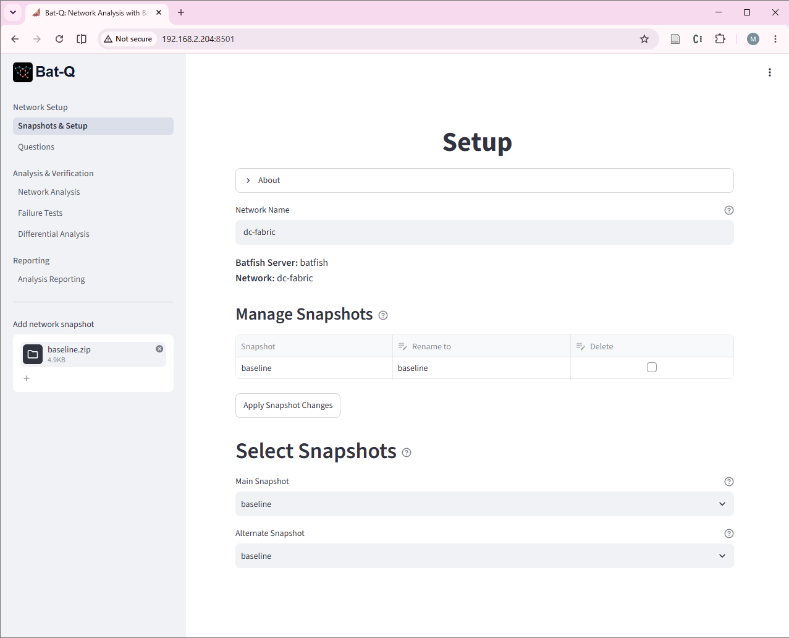
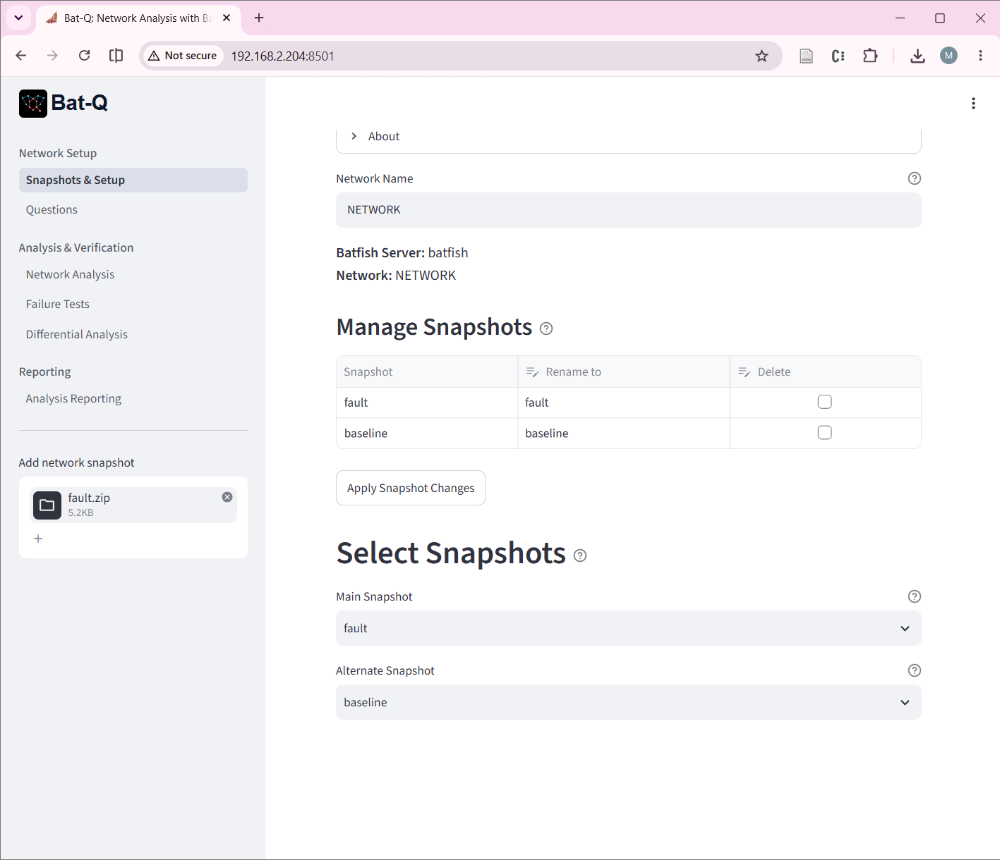

# Lab 2 - Design Verification

In Lab 1 you translated a written design brief into a netlab topology and deployed a data centre fabric. In this lab you check a design against its written requirements in a more systematic way. You will use Bat-Q, a web front end for Batfish. Batfish analyzes device configuration files offline. It never connects to a running device. It reads the configurations, builds a model of the network, and predicts topology, BGP session status, and routes from that model. Because the analysis works on files, the same method can be applied to a proposed or modified configuration before it is pushed to any device.

The fabric has the same structure as in Lab 1, but this time netlab's fabric plugin generates the links, the addressing, and the routing design from a short description. You will deploy the topology, collect its configurations, load them into Batfish, and test the design against six written requirements.

The lab has two parts. In Part A you build a Batfish snapshot from the configurations of the deployed fabric and learn what Batfish reports. In Part B you write an acceptance criterion for each requirement, find the evidence in Bat-Q, and record whether the design passes. You then introduce three realistic configuration errors into a copy of the snapshot, predict their effects, and compare your predictions with the differential analysis. 


# Lab Objectives

By the end of this lab, you will be able to:

1. Explain why offline analysis of device configurations is a verification activity, and state what it can and cannot tell you about a running network.
2. Build a Batfish snapshot from the configurations of a deployed netlab fabric, confirm that Batfish recognized every file, and explain the parse warnings that remain.
3. Translate written design requirements into acceptance criteria, identify the Bat-Q question that provides the evidence for each one, and record a pass or fail result.
4. Predict which requirements will fail when design errors are introduced into a copy of the configurations, then compare your predictions with the differential analysis in Bat-Q.
5. Use Batfish failure analysis to observe the effect of a node or link failure, and explain what this analysis can and cannot say about a recovery time requirement.
6. Produce a requirements traceability record that links each requirement to the design decision that implements it, the evidence that checks it, and its result.

# Lab Environment and Preparation

You will need:

- Your assigned Ubuntu VM IP address provided in Brightspace: ________________.
- netlab, Containerlab, Docker, Ansible, and Python 3 preinstalled.
- The `ceos:v4.36` Docker image available locally.
- The Batfish service running on your VM as a Docker container.
- Bat-Q, available in your browser at `http://<vm-ip>:8501`.

This lab does not depend on Lab 1 files. You will create the topology file in Task 1.


## If Things Go Wrong

>- YAML is indentation sensitive. Validate a hand edited topology with `python3 -c "import yaml; yaml.safe_load(open('dc-fabric.yml'))"` before running netlab.
>- If `netlab up` reports that a node failed to start, run `netlab down` before trying again.
>- If Bat-Q shows no snapshots or an empty table, confirm the snapshot folder has a `configs` subfolder and that the folder has files. Batfish ignores anything outside that structure.
>- If a Bat-Q question returns no rows, that is an answer, not an error. Check your filter values first, a misspelled node name returns nothing.
>- If you damage the VM itself rather than just the lab environment, stop and contact your instructor.


# Part A: From a Running Fabric to a Batfish Snapshot

## Task 0: Environment Setup

Objective: confirm that the tools for this lab are available.

1. Create `docker-compose.yml` file.

   ```bash
   cd ~/labs
   nano docker-compose.yml
   ```

   ```yaml
   services:
     batfish:
       image: batfish/allinone:latest
       container_name: batfish
       ports:
         - "9996:9996"
       volumes:
         - batfish-data:/data

     bat-q:
       image: docker-bat-q:latest
       container_name: bat-q
       ports:
         - "8501:8501"
       environment:
         - BATFISH_SERVER=batfish
       depends_on:
         - batfish

   volumes:
     batfish-data:
   ```

2. Start Batfish and Bat-Q containers.

   ```bash
   docker compose up -d
   ```

3. Open Bat-Q in your browser at `http://<vm-ip>:8501`. Confirm the page loads and that it reports a connection to Batfish.

4. Confirm netlab knows the device images and view available modules.

   ```bash
   netlab show images
   netlab show modules
   ```

5. You will need to use pyBatfish module in this lab. Create Python virtual environment in the root labs folder.

   ```bash
   python3 -m venv .vedsgn
   ```

6. Create lab2 folders

   ```bash
   mkdir -p ~/labs/lab2/topology ~/labs/lab2/snapshots
   ```

### Questions and Deliverables

1. Provide the output of the `docker ps` command from step 2.
2. How do you confirm that BGP is supported in `eos`?

## Task 1: Generating and Deploying the Fabric

Objective: describe the network topology in a few lines of YAML, let netlab generate the details, and understand what it generated.

In Lab 1 you created the topology by describing the nodes and the connection among the. You also provided the addressing pools for the links and loopback interfaces. In this labs, you will use the netlab's `fabric` plugin to create the entire topology from a short description specifying the number of spine and leaf routers. The `bgp` module line selects the routing design.

Netlab plugins are dynamically loadable extensions that allow users to implement custom data model transformations, configure advanced networking features, or add specialized behaviors without altering the core topology engine. Some plugins are built-in while others are custom-written scripts designed for specific requirements.

The built-in `fabric` topology can be customized. This lab specifies custom router names, and AS numbers. It also removes IGP connections among the spine routers. To enable ECMP, netlab can insert additional commands into the BGP configuration via Jinja2 templates.

1. Create the topology file.

   ```bash
   cd ~/labs/lab2/topology
   nano dc-fabric.yml
   ```

   ```yaml
   name: dc-fabric-2
   provider: clab

   defaults.bgp.warnings.missing_igp: False
   defaults.device: eos

   plugin: [ fabric ]
   module: [ bgp ]

   fabric:
     spines: 2
     leafs: 3

   # Custom nodes names
   fabric.spine.name: r1{count}
   fabric.leaf.name: r2{count}

   # Enable Equal-Cost Multi-Path (ECMP)
   groups:
     leaf_nodes:
       members: [ r21, r22, r23 ]
       config: [ bgp-multipath ]     # custom config template

   # Specify AS numbers
   nodes:
     r11:
       bgp.as: 65000
       bgp.sessions:
         ipv4: [ebgp]   # Only keep EBGP sessions, remove IBGP
     r12:
       bgp.as: 65000
       bgp.sessions:
         ipv4: [ebgp]   # Only keep EBGP sessions, remove IBGP
     r21:
       bgp.as: 65001
     r22:
       bgp.as: 65002
     r23:
       bgp.as: 65003
   ```

   Create the jinija2 template in the same directory as the topology file.

   ```bash
   cat <<'EOF' > bgp-multipath.eos.j2
   router bgp {{ bgp.as }}
      maximum-paths 2
   EOF
   ```

2. Validate the file and ask netlab to create its internal data without starting anything.

   ```bash
   python3 -c "import yaml; yaml.safe_load(open('dc-fabric.yml'))"
   netlab create dc-fabric.yml
   ```

3. Create addressing and wiring report. Keep this information to use later.

   ```bash
   netlab report addressing
   netlab report wiring
   ```

4. Deploy the fabric.

   ```bash
   netlab up dc-fabric.yml
   ```

5. Wait about one minute for the sessions to come up, then check BGP on a spine.

   ```bash
   ansible r11 -m arista.eos.eos_command -a "commands='show ip bgp summary'"
   ansible r11 -m arista.eos.eos_command -a "commands='show ip route bgp'"
   ```

   Repeat the same commands on leaf r22.

6. Look at what netlab generated for BGP on r22.

   ```bash
   ansible r22 -m arista.eos.eos_command -a \
       "commands='show running-config section bgp'"
   ```

### Questions and Deliverables

1. Provide the output of `show ip bgp summary` from r11 and from r22.
2. Provide the addressing report generated by netlab
3. netlab created eBGP sessions automatically. What in your topology file told it which pairs of nodes should form a session, and why is no session created between r11 and r12?

## Task 2: Building the Batfish Snapshot

Objective: capture the configuration of every node and arrange it in the folder structure Batfish expects.

A Batfish snapshot is a folder that contains a `configs` subfolder with one configuration file per device. You will take the configurations from the running fabric, so the snapshot reflects what was actually generated and deployed, not what you intended to write in YAML.

1. Create the snapshot folder structure.

   ```bash
   mkdir -p ~/labs/lab2/snapshots/baseline/configs
   ```

2. Create `collect-config.yml` in the topology folder:

   ```bash
   cd ~/labs/lab2/topology
   nano collect-config.yml
   ```

   ```yaml
   ---
   - name: Backup Configurations from cEOS
     hosts: eos
     gather_facts: false
     vars:
       snapshot_dir: "../snapshots/baseline/configs"

     tasks:
       - name: Backup cEOS Running Configuration
         arista.eos.eos_config:
           backup: yes
           backup_options:
             dir_path: "{{ snapshot_dir }}"
             filename: "{{ inventory_hostname }}.cfg"
   ```

3. Collect the running configuration of every node into its own file using Ansible playbook.

   ```bash
   ansible-playbook collect-config.yml 
   ```

4. Check the result. You should see five files of similar size, and each should contain a hostname and a BGP process.

   ```bash
   ls -l ../snapshots/baseline/configs/
   head -n 2 ../snapshots/baseline/configs/*.cfg
   grep "router bgp" ../snapshots/baseline/configs/*.cfg
   ```

5. The files are text. Open one and find the interface that faces r11 on leaf r22. Note its name and address.

   ```bash
   grep -n -A4 "^interface" ../snapshots/baseline/configs/r22.cfg
   ```

### Questions and Deliverables

1. Provide the output of the `ls` and `grep` commands from step 3.
2. Why is it better to build the snapshot from the collected device configurations than from the topology file `dc-fabric.yml`? Think about what each one can and cannot reveal about errors in the deployed network.

## Task 3: A First Look with Bat-Q

Objective: load the snapshot, confirm Batfish understood it, and read the basic facts it extracts, before writing any assertion.

Batfish does not support all Arista CLI commands that appear in the configuration files. As as result, these lines cause Batfish to issue warnings, or in some cases, cause parsing error. Therefore, before the snapshot is loaded, you need to remove some of these lines that do not affect the verification process.


1. Create a shell script that scan the router config files and remove some lines:

   ```bash
   cd ~/labs/lab2/snapshots
   ```

   ```bash
   cat << 'EOF' > cleanup.sh
   #!/bin/bash
   for f in baseline/configs/*.cfg; do sed -i '/next-hop-self/d' "$f"; done
   for f in baseline/configs/*.cfg; do sed -i '/^ip host/d' "$f"; done
   for f in baseline/configs/*.cfg; do sed -i '/mac-address/d' "$f"; done
   EOF
   ```

   ```bash
   chmod +x cleanup.sh
   ./cleanup.sh
   ```

2. Bat-Q require uploading a `.zip` file that includes all configuration, which requires access to the local machine file system. Alternatively, you can upload the configuration folder directly to Batfish container. For this, you will need to install pyBatfish and write a small piece of code.

   ```bash
   cd ~/labs
   source .vedsgn/bin/activate
   pip install pybatfish
   ```

3. Create the `upload_snapshot.py` code:

   ```bash
   cat << 'EOF' > upload_snapshot.py
   import os, sys
   from pybatfish.client.session import Session
   p = sys.argv[1]
   bf = Session(host="localhost")
   bf.set_network("NETWORK")
   bf.init_snapshot(p, name=os.path.basename(p.rstrip("/")), overwrite=True)
   EOF
   ```

   and upload the snapshot

   ```bash
   python upload_snapshot.py lab2/snapshots/baseline/
   ```

4. In Bat-Q's Setup page, confirm that the snapshot is uploaded, as shown in the Figure \ref{fg:setup}.



5. In the Questions page, select the questions:

   ```text
   Snapshot Input
      Snapshot Input File Parse Status
      Snapshot Input File Parse Warnings
   ```   
   
   Then, in the Analysis pages, inspect the results. You should see that every file is parsed and recognized as Arista EOS. Ideally, Batfish should not give any warnings, but the reality is Batfish does not support every vendor's feature and vendors change the CLI with new OS versions, so Batfish lags behind in the support[^support]. Fortunately, the configuration lines that Batfish does not recognize have no affect on the analysis you will conduct in this lab.

6. Back to the Questions page, select the following questions:

   ```text
   Configuration Properties
      Node Properties
      Interface Properties
      BGP Process Configuration
   ```

   In the Analysis pages, confirm that Batfish found five nodes with the hostnames you expect. The results will also show all interfaces including the Management interface, which Batfish ignores by default so it is not considered in the analysis. Confirm that Multipath eBGP and iBGP is enabled on the leaf nodes.

   Now that you know how to go back and forth between the Questions and Analysis pages, the next steps assumes that you will check the results in the Analysis pages after selecting each group of questions

7. Select the following questions and observe the answers.

   ```text
   Topology
      Layer 3 Topology

   Routing Protocol Sessions and Policies
      BGP Session Status
      BGP Edges

   Routing and Forwarding Tables
      Routes (add `protocol = bgp` in the options)
   ```

   Batfish infers links by finding interfaces that share a subnet. It reports every link as two directed edges, one from each end, so the six physical links of the fabric appear as twelve edges. Count the edges and compare.

   The BGP Session Status question provide information about the session type, the local and remote ASN, and the status of each session. The BGP Edges question gives all BGP links and the resulting topology, which in this case, it will match the Layer 3 topology. The Routes questions shows all routes learned by all nodes. Confirm that each leaf can reach each other leaf using the loopback IP address.

8. Save your questions set by clicking on the button "Save selection to YAML" on the sidebar on the Questions page (optional: rename the file).

9. Go to the Analysis Reporting page. Bat-Q will generate a report of all the answers to the selected questions. Download the report by clicking on the button in the sidebar.

[^support]: This is one of the main motivation for model-driven configuration and management of networks, instead for relying on CLI.

### Questions and Deliverables

1. Convert the generated HTML report to pdf using your browser print-to-pdf and include the report in your submission.
2. Batfish predicted the state of the sessions without connecting to any device. Describe in two or three sentences how it could do that, and what it would need to know to be wrong.

# Part B: Verifying the Design Against Its Requirements

In Part A you looked at what Batfish knows about the fabric. In Part B you use that knowledge to answer one question: does the design satisfy its requirements? Requirement R1 to R5 in Appendix A can be checked from the configuration alone. Requirement R6 cannot, and you will find out why.

## Task 4: Checking the Design Against Its Requirements

Objective: take each written requirement, decide which Bat-Q question gives the evidence, and record whether the baseline fabric satisfies it.

A requirement is only useful if you can say what evidence would show that it is met. Chapter 3 calls this the acceptance criterion. In this task you write the acceptance criterion for each requirement, find the evidence in Bat-Q, and judge pass or fail.

1. Make sure the snapshot `baseline` is the main snapshot in the Setup page, and that the questions from Task 3 are selected.

2. Create a file named `check.md` in `~/labs/lab2`. Copy the table below into it. The first two rows show the style of answer expected. In the Evidence column, write what you actually saw in Bat-Q, for example the node names and counts. Do not write "looks fine".

   | Req | Bat-Q question | What would show the requirement is met | Evidence from the baseline | Result |
   | :---- | :---- | :---- | :---- | :---- |
   | R1 | Layer 3 Topology | Each leaf has exactly one edge to r11 and one edge to r12 (each also appears in the reverse direction) | r21 to r11 and r12, r22 to r11 and r12, r23 to r11 and r12 | Pass |
   | R2 | Layer 3 Topology | No edge joins r11 and r12, and no edge joins two leaves | No such edges in the table or in the diagram | Pass |
   | R3 | | | | |
   | R4 | | | | |
   | R5 | | | | |
   | R6 | | | | |

3. Complete the rows R3 to R6. These hints tell you where to look.

   - For R3, the BGP Session Status table has Local_AS and Remote_AS columns.
   - For R4, the BGP Session Status table has twelve rows, because each of the six sessions appears once from each end. Count the rows and read the Established_Status column. State both numbers in your evidence: six sessions, twelve rows.
   - For R5, you need the loopback address of every node. Use your addressing record from Task 1. Then use the Bat-Q question that lists BGP routes, and look at the routes on each leaf. Each remote leaf loopback should appear with two different next hops, one through each spine.
   - For R6, decide whether any Bat-Q question can give evidence. If not, write the reason and the verification method from Chapter 3 that you would use instead.

4. Save the file and keep it open. You will complete the last column in the next task.

### Questions and Deliverables

1. Submit `check.md` with the first four columns completed.
2. Requirement R3 says that each leaf has its own unique ASN. It does not say which ASN. Is that a weakness? Write a version of R3 that is easier to verify and that someone could not satisfy by accident.
3. Which of the six requirements could you check by looking at the topology file `dc-fabric.yml` alone, and which needed the Batfish results? What does that tell you about the value of checking the generated configuration?


## Task 5: Catching Design Errors Before Deployment

Objective: introduce realistic errors into copies of the configuration, predict their effect, and see whether your assertions catch them.

Each error below is the kind of mistake that appears during manual changes, a rushed maintenance window, or a bad template. You will edit configuration files only, nothing is deployed and the running fabric is not touched.

- Wrong ASN on r22
- Wrong interface address on r12
- Uplink administratively shut down on r23

1. Copy the baseline snapshot

   ```bash
   cd ~/labs/lab2/snapshots
   cp -r baseline fault
   ```

2. Create a script that modifies the configuration files to introduce errors:


   ```bash
   cat << 'EOF' > faults.sh
   #!/bin/bash

   # Introduce configuration errors
   # Incorrect ASN
   sed -i 's/router bgp 65002/router bgp 65102/g' fault/configs/r22.cfg
   # Incorrect IP address
   sed -i 's/ip address 10.1.0.21/ip address 10.1.0.121/g' fault/configs/r12.cfg
   # Incorrect interface admin status
   sed -i '/^interface Ethernet1$/,/^interface/ {
      /^[[:space:]]*shutdown$/d
      /interface Ethernet1/a\   shutdown
   }' fault/configs/r23.cfg
   EOF
   ```

   and run the script

   ```bash
   chmod +x faults.sh
   ./faults.sh
   ```

3. Before you upload the faulty snapshot, predict the effect of the three faults on the requirements.

   Add a column named Fault prediction to your check.md table. For each of R1 to R5, write whether you expect the requirement to pass or fail on the faulty snapshot, with a one sentence reason. Do this before you upload the faulty snapshot. Think about which links and sessions each fault touches. Two of the faults affect the same router.

4. Upload the folder.

   ```bash
   cd ~/labs
   python upload_snapshot.py lab2/snapshots/fault/
   ```

5. In Bat-Q, select the fault snapshot as the main snapshot and the baseline as the alternate snapshot, as shown in Figure \ref{fg:select}.



6. Make sure the previous question remain selected in the questions page. Reselect them if needed (or upload the saved file)

7. Go the analysis page and review at the answers. Notice the differences in the topology, interfaces, and BGP sessions status (how many are established)

8. Go to the Differential Analysis page. Batfish compares the faulty snapshot (called Reference) with the original baseline (called Snapshot). The reference snapshot is the faulty one. Here is some of what you will see:

   In the interface properties:
   
   - Interface r12/Ethernet3 appears in both snapshots but the IP addresses are different
   - Interface r23/Ethernet1 appears only in the Snapshot (the original).

   In the BGP Session Status:

   - All BGP sessions that are different appear with the differences in the Local_IP and the Established Status columns (You may need to scroll horizontally to see  all columns)

   You will find an empty answer in the Node Properties because both snapshot have the same nodes so there is no difference. In other words, the set of differences is empty

9. Complete the last column of check.md. Add a column named Fault result and fill it in from the results you see for the faulty snapshot, using the same style of evidence as in Task 4.

### Questions and Deliverables

1. Report the differences in the Layer 3 Topology and BGP Edges. Download the table and the image from the menus in the upper-right of each and include them with your answer.
2. Submit `check.md` with both the prediction and the result columns completed.
3. Where did your predictions differ from the results? Explain one difference.
4. After the faults, requirement R3 as written still passes. Explain why, and say which requirement caught the error instead. Does your improved wording of R3 from Task 4 catch it?
5. A teammate says the fabric is tested after deployment anyway, so this check is redundant. Write a short reply based on the cost of fixing an error at each stage of the design process.


## Task 6: Failure Analysis

Objective: investigate some failure modes and observe the network response.

Failure analysis is one of the most useful features in Batfish. It allows you to test node or interface failure scenarios without configuration changes or physical manipulation. This feature will be explored further in a future lab.

1. Back in the Setup page, select the original baseline snapshot to be the main snapshot.

2. Make sure the same set of questions remain selected in the Questions page.

3. In the Failure Analysis, select r11 as the failed node. All questions will be answered based on this selection. What does the L3 Topology look like? 

   Note that Batfish does not delete node r11, so it appears in some tables as having no connections.

4. Clear the failed nodes selection and select `r12[Ethernet1]` as failed interface. Observe the L3 Topology and the BGP sessions

### Questions and Deliverables

1. Write your observations in steps 3 and 4 and attached the relevant images in each case.
2. Requirement R6 asks for recovery within three seconds. Looking at what Batfish showed you when r12[Ethernet1] failed, what can the analysis tell you about R6, and what can it not tell you?

## Task 7: Traceability Record

Objective: record, in one document, the chain from requirement to design decision to evidence to result.

1. Create a file named `rtm.md` in `~/labs/lab2`. Complete one row for each requirement. The Design decision column names the netlab construct in `dc-fabric.yml` that implements the requirement. The Evidence column refers to the row in `check.md`. The Method column uses the four verification methods from Chapter 3. The first row is completed as an example.

| Req | Design decision in dc-fabric.yml | Evidence | Baseline | Faulty snapshot | Method |
| :---- | :---- | :---- | :---- | :---- | :---- |
| R1 | fabric.spines and fabric.leafs, which link every leaf to every spine | Layer 3 Topology | Pass | Fail | Analysis |

2. For R6, leave the Baseline and Faulty snapshot columns as Not verified, and state in the Method column how it will be verified.

### Questions and Deliverables

1. Submit `rtm.md`.
2. Chapter 1 lists the Site Acceptance Test plan as a design deliverable. In one paragraph, explain how the table in `check.md` could become part of a Site Acceptance Test plan, and what other test types the plan would still need.


# Wrap Up

The fabric is fully defined by `dc-fabric.yml`, and the snapshots are plain files in your repository. Nothing on the running nodes needs to be saved.

1. Shutdown the topology.

   ```bash
   cd ~/labs/lab2/topology
   netlab down --cleanup
   ```

2. Deactivate the Python virtual environment

   ```bash
   deactivate
   ```

3. Move to the root of your repository and stop and remove the Batfish and Bat-Q containers

   ```bash
   cd ~/labs
   docker compose down
   ```

4. Check git status. Confirm that auto generated Containerlab folders are not tracked.

   ```bash
   git status
   ```

3. Stage, commit, and tag this checkpoint.

   ```bash
   git add lab2
   git commit -m \
       "Add Lab 2 BGP topology, Batfish snapshots, and traceability record"
   git tag lab2-complete
   ```

# Submission

Provide the answers to the questions in each task in .docx or .pdf formats. Do not append the answers to this assignment file.


# Appendix A: Design Requirements


: Design Requirements

| ID | Requirement |
| :--- | :------------ |
| R1 | Every leaf connects to both spines, with exactly one link to each. |
| R2 | There is no link between the two spines and no link between any two leaves. |
| R3 | Both spines use ASN 65000, and each leaf has its own unique ASN |
| R4 | Every BGP session between a spine and a leaf is established. There are six sessions, and Batfish lists each one from both ends, so twelve rows are expected, all with status ESTABLISHED. |
| R5 | Every leaf learns the loopback address of every other leaf from both spines, so that two candidate paths exist. |
| R6 | After a single link failure, traffic between any two leaves resumes within three seconds. |

R6 is included on purpose. You will find that it cannot be tested in this lab, and Lab 3 returns to it.

