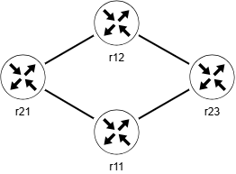

# Lab 3 - Reliability Analysis

In Lab 2 you verified that the data centre fabric satisfies its structural requirements. A design can pass every structural check and still fail its users when something breaks. Reliability requirements ask a different question: what happens to the service when a component fails, and how quickly does the service come back?

This lab answers that question in two steps. First, you use the failure analysis feature of Batfish to predict what each failure does to the fabric, without touching any device. Second, you cause real failures on the running fabric and measure what actually happens. The sequence is deliberate: predict, then validate.

Batfish analyzes configurations and computes routes but it does not model timers or convergence. It can tell you whether a path exists after a failure. It cannot tell you how long the network takes to find that path, because it does not model timers, detection delays, or convergence. Only the live network can provide this information, so the two parts of this lab answer different parts of the same requirement.


# Lab Objectives

By the end of this lab, you will be able to:

1. Use Batfish failure analysis to find single points of failure and to describe the failure domain of each node and link in a spine and leaf fabric.
2. Predict the effect of node and link failures on reachability before testing them.
3. Calculate the availability of a leaf to leaf service from component availabilities using series and parallel path models.
4. Measure the outage caused by a link failure and by a node failure on a live fabric, and compare it with a convergence requirement with and without ECMP.

<!--5. Explain which parts of a reliability requirement an offline analysis can verify and which need testing on the running network.-->

# Lab Environment and Preparation

You will need:

- Your assigned Ubuntu VM IP address provided in Brightspace: ________________.
- netlab, Containerlab, Docker, and Ansible preinstalled.
- The Arista cEOS Docker image available locally.
- Batfish and Bat-Q

## Starting Point

Make sure no netlab topology is active:

```bash
netlab status --all
```

If you see any instance, shut it down using the instance id provided in the output.

```bash
netlab down -i default --cleanup
```

This lab builds on the fabric and the baseline snapshot from Lab 2. If you have not completed Lab 2, consult with the instructor.


```bash
cd ~/labs
mkdir -p ~/labs/lab3/topology ~/labs/lab3/snapshots
cp -r ~/labs/lab2/topology/ ~/labs/lab3/
cp -r ~/labs/lab2/snapshots/baseline/ ~/labs/lab3/snapshots/
```

Activate Python virtual environment from the root labs folder,

```bash
source .vedsgn/bin/activate
```

## If Things Go Wrong

>- If netlab up reports that a node failed to start, run netlab down before trying again.
>- If you forget to restore a failed link or node, the next experiment will start from the wrong state. Restore after every experiment and confirm with `show ip bgp summary`.
>- If you damage the VM itself rather than just the lab environment, stop and contact your instructor.

\newpage

# Part A: Predicting Failures

## Task 0: Environment Review

Objective: start the analysis tools.

1. Start Batfish and Bat-Q:

   ```bash
   cd ~/labs
   docker compose up -d
   ```

2. Upload the `baseline` folder to Bat-Q and name the network `dc-fabric`.

   ```bash
   python upload_snapshot.py lab3/snapshots/baseline/
   ```

3. In your browser, go to `http://<your VM IP address>:8501`. Make sure the `baseline` snapshot is loaded in the Setup page. In the Questions page, select the questions below.

   ```text
   Topology
      Layer 3 Topology

   Routing Protocol Sessions and Policies
      BGP Session Status

   Routing and Forwarding Tables
      Routes (Options: protocols=bgp)

   Packet Forwarding
      Traceroute (Options: startLocation=r21, headers={'dstIps':'r22'})
   ```

4. Open the Analysis pages and confirm that the baseline snapshot shows five nodes, six links, and twelve established BGP session rows.

5. Write down the loopback address of every node. You need these addresses in every task of this lab. You can also get addresses from Bat-Q (which question can you use?) or from your lab 2 folder.

### Questions and Deliverables

1. Provide the output of the BGP Session Status.
2. Provide a table of node names and loopback addresses.
3. Confirm that `r21` has two paths to `r22`.

## Task 1: Predicting Failures with Batfish

Objective: find out what happens to the fabric when a node or a link fails, using only the configuration snapshot.

Failure analysis in Bat-Q lets you mark nodes or interfaces as failed. Batfish then answers the selected questions as if those components were down. The snapshot is not modified and nothing is deployed.

For each scenario in turn, open the Failure Analysis page, select the failed nodes or interfaces, and review the Layer 3 Topology, the BGP Session Status, and the BGP routes. A leaf can reach another leaf when the loopback of the other leaf appears as a BGP route on the first leaf. Clear the selection before starting the next scenario.

| Scenario | Failed component | Leaves `r21` and `r22`  can reach each other | Established session rows |
| :--- | :------------ | :--- | :--- |
| S0 | None, baseline | Yes | 12 |
| S1 | Spine r11 | |
| S2 | Leaf r23 | |
| S3 | Both spines, r11 and r12 | |
| S4 | Link r11-r22 (r11[Ethernet2])  | |
| S5 | Both uplinks of leaf r23 (r23[Ethernet1] & r23[Ethernet2])| |
| S6 | Link r11-r22 (r11[Ethernet2]) & link r12-r21 (r12[Ethernet1]) | |


### Questions and Deliverables

1. Submit the completed table, with a screenshot of the Layer 3 Topology for scenario S6.
2. Is there any single point of failure in this fabric for leaf-to-leaf reachability?
3. For each node type, state the failure domain of one node failure in terms of the devices that lose connectivity. Compare the failure domain of a spine with that of a leaf.
4. State whether the fabric satisfies R7 and R8. Name the scenarios you used as evidence, and explain why S3, S5 and S6 do not count against R7.
5. Scenario S6 does not isolate any node. Why?
6. In S6, why can leaf r23 not provide a path between the two other leaves? Use the AS numbers in your answer.


## Task 2: Predicting Availability by Calculation

Objective: estimate the availability of the leaf to leaf service from the availability of its components, and see which component limits it.

Batfish tells you whether a path exists after a failure. It does not tell you how often failures happen. For that, use the availability models of the course text. In a series arrangement, every component must work, so the availabilities multiply. In a parallel arrangement, the service works if any path works, so the unavailabilities multiply.

Assume these component availabilities for this exercise:

| Component | Availability |
| :---- | :--- |
| Switch (spine or leaf) | 99.95% |
| Link | 100% |

The service is traffic from leaf r21 to leaf r23. It can use the path through spine r11 or the path through spine r12. Figure \ref{fg:service} shows the reliability block diagram for the service. Each path through a spine is a series of a link, a spine, and a link. The two paths are in parallel. The two leaves are in series with the parallel block.




1. Calculate in order:

   - the availability of the two spine paths in parallel,
   - the availability of the whole service as three blocks in series.

2. Convert the availability of the service to expected downtime in minutes per year, using 525,600 minutes in a year.

3. Calculate how much of that downtime comes from the spine layer (the parallel block) and how much comes from the two leaves.

4. The service must meet requirement R9 (99.99% availability). State whether the design meets it.

### Questions and Deliverables

1. Submit the calculations.
2. Which component limits the availability of the service? Does adding a third spine change the result significantly? Explain with the numbers.
3. What design change would improve the availability of a service that runs between two servers, and where in the topology would it be applied? Name the trade-off it introduces.
4. Batfish showed in Task 1 that the fabric survives any single spine failure. Does that mean the service meets R9? Explain.


# Part B: Validating on the Live Fabric

In Part A you predicted what each failure does. In Part B you cause real failures and observe the outage.

## Task 3: Baseline Measurement on the Live Fabric

Objective: find the path that carries the traffic, and show that the test method gives a clean baseline before any failure.


1. Deploy the fabric.

   ```bash
   cd ~/labs/lab3/topology
   netlab up dc-fabric.yml
   ```

2. Wait about one minute, then confirm that all BGP sessions are established from the point of view of one spine and one leaf.

   ```bash
   ansible r11 -m arista.eos.eos_command -a "commands='show ip bgp summary'"
   ansible r21 -m arista.eos.eos_command -a "commands='show ip bgp summary'"
   ```

3. Find the route that r21 uses to reach the loopback of r23. Use the loopback address of r23 from the information you collected previously.

   ```bash
   netlab exec r21 traceroute <r23-loopback> source <r21-loopback>
   ```

   Note which spine is used as the next hop.

4. Find the interface that connects r21 to the active spine:

   ```bash
   netlab exec r21 show lldp neighbors
   netlab exec r23 show lldp neighbors
   ```

5. Send a continuous test stream from the loopback of r21 to the loopback of r23. The stream sends ten packets per second for 30 seconds.

   ```text
   netlab exec r21 ping <r23-loopback> source <r21-loopback> \
          interval 0.1 repeat 300
   ```

6. Wait for the test to finish and record the packet loss reported in the summary. It should be zero.

### Questions and Deliverables

1. Submit the output of the two show commands in step 2.
2. Which spine and interface do r21 and r23 use to reach each other?
3. Submit the summary portion of the ping test.
4. Explain how you will convert the number of lost packets into an outage duration, and state the resolution of your measurement.

## Task 4: Failure Experiments on the Live Fabric

Objective: measure the outage caused by a link failure and by a node failure.

Each experiment follows the same pattern. Open a second terminal then start the test stream in terminal 1. After about 10 seconds, cause the failure in terminal 2. Wait for the stream to finish. Restore the failed component before the next experiment.


### Experiment A: Failure of the link on the active path

1. In terminal 2, find which spine forwards traffic between `r23` and `r21`.

   ```bash
   cd ~/labs/lab3/topology/
   netlab exec r21 traceroute <r23-loopback> source <r21-loopback>
   ```

2. Start the test stream in terminal 1, as in Task 3.

   ```bash
   netlab exec r21 ping <r23-loopback> source <r21-loopback> \
          interval 0.1 repeat 300
   ```

3. In terminal 2, wait 10 seconds, then shut down the interface to the active spine you found in step 1.

   ```bash
   netlab connect r23
   configure
   interface <interface-to-active-spine>
   shutdown
   ```

4. When the test finishes, record the number of lost packets and calculate the outage in milliseconds.

5. Restore the link.

   ```text
   no shutdown
   ```

   Confirm BGP is established `show ip bgp summary` on r23 before continuing.

6. Repeat the experiment once at higher ping rate and record both results.

   ```bash
   netlab exec r21 ping <r23-loopback> source <r21-loopback> \
          interval 0.01 repeat 3000
   ```

7. In terminal 2, exit the router

   ```text
   end
   exit
   ```

### Experiment B: Failure of the active spine

Before you start the experiment, check again, which spine is active on the path between r21 and r23.

Note: The active spine may change over time, so repeat the traceroute test above before continuing.  

1. Start the test stream in terminal 1.

   ```bash
   netlab exec r21 ping <r23-loopback> source <r21-loopback> \
          interval 0.01 repeat 3000
   ```

2. After about ten seconds, in terminal 2, stop the active spine node from the VM shell. You cannot stop the node using netlab, so you will use Containerlab instead.

   ```bash
   containerlab stop -t clab.yml --node <active spine>
   ```

3. When the test finishes, record the lost packets and calculate the outage in milliseconds.

4. Restart the spine and wait for the sessions to come back.

   ```bash
   containerlab start -t clab.yml --node <active spine>
   ```

   The node may need a minute or more to restore its configuration and sessions. Confirm with `show ip bgp summary` on r21 before continuing.

   If the router is not restarting, try restarting the topology:

   ```bash
   netlab restart
   ```

Keep both terminals open.

### Questions and Deliverables

1. Provide a table with one row per run reporting the outage time in milliseconds.
2. Compare the outage in Experiments A and B. If they differ, suggest why.
3. Requirement R6 (from Lab2 and Appendix A) asks for recovery within three seconds after a single link failure. Does the fabric meet it in either experiment?

## Task 5: Resilience without ECMP

Objective: measure the outage caused by a node failure without ECMP.

1. On terminal 1, Edit `dc-fabric.yml` to comment out or delete the ECMP configuration on the leaves so that only one path is active between any two leaves.

   ```bash
   cd ~/labs/lab3/topology
   nano dc-fabric.yml
   ```

   ```bash
   # Enable Equal-Cost Multi-Path (ECMP)
   #groups:
   #   leaf_nodes:
   #      members: [ r21, r22, r23 ]
   #      config: [ bgp-multipath ]     # custom config template
   ```

2. Restart netlab.

   ```bash
   netlan down
   netlab up dc-fabric.yml
   ```

3. Confirm that only one BGP entry is showing on the routing table.

   ```bash
   ansible r21 -m arista.eos.eos_command -a \
       "commands='show ip route <r23-loopback>'"
   ```

4. Take note of the active spine.

   ```bash
   netlab exec r21 traceroute <r23-loopback> source <r21-loopback>
   ```

5. Start the test stream in terminal 1.

   ```bash
   netlab exec r21 ping <r23-loopback> source <r21-loopback> \
          interval 0.01 repeat 3000
   ```

6. After about ten seconds, in terminal 2, stop the active spine node from the VM shell. You cannot stop the node using netlab, so you will use Containerlab instead.

   ```bash
   containerlab stop -t clab.yml --node <active spine>
   ```

7. When the test finishes, record the lost packets and calculate the outage.


### Questions and Deliverables


1. Add the results on this experiment to the table you create in the previous task. Comment on the results. Does ECMP contribute to speed of recovery?
2. The live experiments ran on a virtual environment; would the results be comparable in a physical network environment? Explain.

# Wrap Up

Exit terminal 2

On terminal 1, shutdown netlab

```bash
cd ~/labs/lab3/topology
netlab down --cleanup
```

Stop Batfish and Bat-Q.

```bash
cd ~/labs
docker compose down -v
```

```bash
git status
git add lab3
git commit -m "Add Lab 3 reliability analysis"
git tag lab3-complete
```

# Submission

Provide the answers to the questions in each task in .docx or .pdf formats. Do not append the answers to this assignment file.
 


# Appendix A: Reliability Requirements

Requirements R1 to R6 are the requirements of Lab 2. They are repeated here for reference. R7, R8, and R9 are new.


: Design and Reliability Requirements


| ID | Requirement |
| :--- | :------------ |
| R1 | Every leaf connects to both spines, with exactly one link to each. |
| R2 | There is no link between the two spines and no link between any two leaves. |
| R3 | Both spines use ASN 65000, and each leaf has its own unique ASN. |
| R4 | Every BGP session between a spine and a leaf is established. There are six sessions, and Batfish lists each one from both ends, so twelve rows are expected, all with status ESTABLISHED. |
| R5 | Every leaf learns the loopback address of every other leaf from both spines, so that two candidate paths exist. |
| R6 | After a single link failure, traffic between any two leaves resumes within three seconds. |
| R7 | No single node failure or single link failure disconnects any two surviving leaves from each other. |
| R8 | The failure of a node affects only the devices that depend on that node. In particular, a leaf failure does not affect connectivity between the other leaves. |
| R9 | The service between two leaves has an availability of at least 99.99%. |


# Appendix B: Batfish Failure Analysis in Bat-Q

Failure analysis answers the selected questions on a copy of the snapshot in which the chosen nodes or interfaces are inactive.

| Item | Behaviour |
| :---- | :---- |
| Failed node | All its interfaces are inactive. The node still appears in tables, with no connections. |
| Failed interface | The link attached to the interface disappears from the topology. |
| Several selections | All selected components fail at the same time. |
| Clearing the selection | Returns the answers to the unmodified snapshot. |
| What is not modelled | Detection time, timers, convergence time, and packet loss during the transition. |
